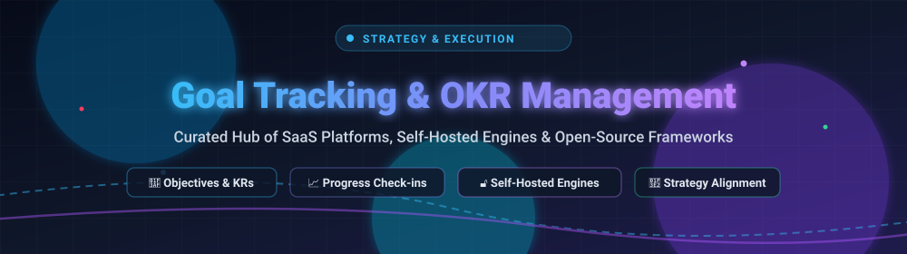
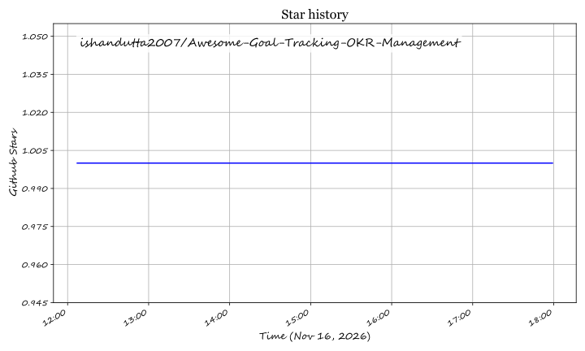

  

# 🎯 Awesome Goal Tracking &amp; OKR Management 🚀

### 🌟 Top Goal Tracking &amp; OKR Management Ecosystem

**Curated Directory of SaaS Platforms &amp; Open-Source Projects for Objectives &amp; Key Results (OKRs), Strategy Alignment, Weekly Check-ins &amp; Self-Hosted Goal Engines**  
*Last updated: March 2026*

---

## 📌 Overview & Ecosystem Context

Welcome to **Awesome Goal Tracking & OKR Management**! This repository tracks the most notable **SaaS platforms** and **open-source repositories** designed for **Goal Tracking, OKRs (Objectives and Key Results), Strategy Execution, and Continuous Performance Management**. 

These tools empower leadership teams, engineering managers, and individual contributors to:
- 🎯 **Define ambitious Objectives & quantifiable Key Results** with metric-backed targets.
- 🔄 **Automate progress check-ins** without chasing updates across spreadsheets and status meetings.
- 🔗 **Bridge the strategy-to-execution gap** by tying day-to-day projects and tasks directly to top-level organizational goals.
- 🛡️ **Maintain data sovereignty & eliminate the per-seat growth tax** using production-grade self-hosted, open-source goal engines.

Whether you're an enterprise executive comparing market leaders like **Lattice**, **15Five**, and **Betterworks**, or a developer self-hosting **Operately**, **OpenProject**, or **Leantime**, this curated collection provides verified pricing, free tier limits, company sizes, and open-source star metrics.

---

## 📑 Table of Contents

- [📊 Sector Overview & Market Dynamics](#-sector-overview--market-dynamics)
- [☁️ SaaS / Hosted Platforms](#️-saas--hosted-platforms)
- [🔓 Open-Source GitHub Projects](#-open-source-github-projects)
- [🛠️ Choosing the Right System](#️-choosing-the-right-system)
- [🤝 How to Contribute](#-how-to-contribute)
- [💖 Support](#-support)
- [⭐ Star History](#-star-history)
- [⚠️ Disclaimer](#️-disclaimer)

---

## 📊 Sector Overview & Market Dynamics

The global **OKR and Goal-Management Software Market** is currently valued at approximately **$1.4 billion to $1.5 billion** (expanding at a compound annual growth rate of ~14–15% toward $3B–$5B+ by the mid-2030s), while the wider **Performance and Goal Management Software** ecosystem exceeds **$5 billion**. 

Market concentration is **moderately fragmented**:
- 🌐 **At the base & startup tier**, the market is highly fragmented with dozens of specialized point solutions, plugins, and self-hosted tools competing on ease of adoption, focused check-in workflows, and developer-friendly setups.
- 🏢 **At the enterprise tier**, the landscape is consolidating into multi-product continuous performance ecosystems (such as Lattice, Betterworks, and WorkBoard post-Quantive acquisition) that bundle OKRs alongside 360-degree performance reviews, engagement surveys, and compensation planning to defend high annual contract values (ACVs).

---

## ☁️ SaaS / Hosted Platforms

Below is a comparison of top commercial SaaS platforms for goal tracking and OKRs, sorted in descending order by **Company Size (Valuation / Revenue)**.

| Product | Company Size (Valuation / Revenue) | Description | Pricing (Starting) | Free Tier / Trial Limits |
|---------|-----------------------------------|-------------|-------------------|--------------------------|
| **[Lattice](https://lattice.com/)** | **~$3.0B Valuation** (~$130M ARR) | Enterprise performance management suite integrating goals, OKRs, reviews, and continuous employee feedback. | Goals module: **$8/seat/month** (or Performance + OKRs at **$11/seat/month**); minimum annual agreement **$4,000/year** | No self-serve free trial and no free tier; interactive click-through product tours and guided live demos upon request |
| **[15Five](https://www.15five.com/)** | **~$250M–$500M Est. Valuation** (~$50M–$100M Revenue, $98M Raised) | **Performance management with OKRs built into the Perform tier.** Includes OKRs & goals, 1-on-1s, and check-ins. | Perform: **$11/user/month** (billed annually, min. contract); Total Platform: **$16/user/month** | **14-day free trial** with full feature access; no permanent free tier |
| **[Betterworks](https://www.betterworks.com/)** | **~$177M Valuation** (~$25M–$40M ARR, $159M Raised) | Enterprise OKR and continuous performance management system designed for large organizations. | Performance: **$8/user/month** (billed annually, ~$96/user/year plus one-time implementation fee) | No public self-serve free trial and no permanent free tier; guided pilot trial and custom sandbox upon sales demo |
| **[Quantive Results](https://quantive.com/)** | **Acquired by WorkBoard** (~$35M ARR, $161M Raised prior to exit) | **Strategy execution platform with OKRs at the foundation.** Essentials plan is free for up to 5 users. Growth tier starts at $9/user/month. | Growth: **$9/user/month** (annual); Essentials: **$0** (free tier up to 5 users) | **Free forever plan**: Up to 5 users, basic OKR tracking; enterprise proof-of-concept trial available via sales demo |
| **[Perdoo](https://www.perdoo.com/)** | **~$1.8M–$2.6M Revenue** (Seed stage, <$1M Raised) | OKR and strategy execution platform featuring interactive strategy maps, KPI dashboards, and weekly check-ins. | Premium: **€6.40/user/month** (billed annually, min. 10 users / €64/mo); Free plan: **€0** | **Free forever plan**: Up to 5 users with full OKRs, KPIs, strategy maps, and Slack/Teams integrations |
| **[Weekdone](https://weekdone.com/)** | **~$1.5M Revenue** (Early-stage/Bootstrapped, $290K Raised) | Weekly OKR tracking, team progress check-ins, and automated 3P (Plans, Progress, Problems) reporting. | Paid plans: from **$10.80/user/month** (annual billing, 4–10 users tier) or **$90/month** team package | **Free forever plan**: Up to 3 users with full platform features; automatically transitions to a **14-day free trial** when adding 4+ users |

---

## 🔓 Open-Source GitHub Projects

Self-hosted and open-source OKR tools give engineering teams full data sovereignty, zero per-seat licensing fees, and direct database/API extensibility.

The table below includes all major active open-source goal-tracking engines, suites, and templates, sorted in descending order by **GitHub Stars_Count**.

| Project | GitHub_Stars | License | Description |
|---------|-------|---------|-------------|
| **[Odoo](https://github.com/odoo/odoo)** |  | LGPLv3 | **Enterprise open-source ERP with native Goals & Gamification modules.** Connects high-level business objectives directly to operational ERP metrics (sales, invoices, projects), eliminating manual status reports. |
| **[OpenProject](https://github.com/opf/openproject)** |  | GPLv3 | **Full-featured project management suite with native OKR tracking.** Embeds OKR work packages directly into portfolio boards, Gantt timelines, and agile sprints—ideal for organizations needing compliance and project traceability. |
| **[Leantime](https://github.com/Leantime/leantime)** |  | AGPLv3 | **Strategy and goal-focused project management platform designed for neurodivergent teams (ADHD/autism/dyslexia friendly).** Bridges company strategy with everyday execution via strategic canvases, milestone tracking, and goal trees. |
| **[Operately](https://github.com/operately/operately)** |  | Apache-2.0 | **The modern open-source company operating system.** Connects company goals and OKRs directly to active projects, automatic structured weekly check-ins, and transparent department updates. Offers CLI & AI agent skills for autonomous goal reporting. |
| **[Tatsu](https://github.com/ZhengJiawen44/tatsu)** |  | MIT | **Next.js productivity and long-term goal tracking application.** Features gamified evolving avatars, Notion-like rich text editor, end-to-end encrypted file storage, and goal milestone tracking. |
| **[OKR Tracker](https://github.com/oslokommune/okr-tracker)** |  | MIT | **Production-tested OKR & KPI tracking frontend built by the City of Oslo.** Designed for multidisciplinary product teams to set organizational objectives, connect Key Results, and monitor real-time KPIs with a Firebase backend. |
| **[OpenOKR](https://github.com/timothywarner/OpenOKR)** |  | MIT | **Lightweight standalone OKR tool focused on behavioral OKR hygiene.** Provides automated weekly check-in prompts, confidence ratings (1–10) over time, and interactive chronological confidence trends to flag at-risk results early. |
| **[Personal OKRs Template](https://github.com/AnandChowdhary/okrs)** |  | MIT | **Git-based public OKR tracking template.** Demonstrates tracking annual and quarterly Objectives and Key Results directly in Git version control with automated CI workflows. |
| **[OKR OS](https://github.com/credifit-br/okr_os)** |  | MIT | **Self-hosted OKR management engine built for growing engineering teams.** Provides an open-source management dashboard to organize company-wide and departmental key results without SaaS subscriptions. |
| **[Puzzle OKR](https://github.com/puzzle/okr)** |  | MIT | **Clean web application tailored for managing corporate and squad OKRs.** Enables hierarchical objective nesting, owner assignment, and transparent progress monitoring across teams. |
| **[SMART OKRs & KPIs Guide](https://github.com/joelparkerhenderson/smart-okrs-kpis)** |  | MIT | **Comprehensive open-source handbook, schemas, and templates for SMART OKRs & KPIs.** Contains production-ready markdown blueprints for strategy, executive alignment, and metric definition. |
| **[Open-OKR](https://github.com/open-okr/open-okr)** |  | AGPLv3 | **Modern AI-native open-source OKR platform.** Easily deployed via Docker Compose or Kubernetes (Helm) with PostgreSQL; offers full features, audit logging, and SSO without artificial user limitations. |
| **[Obsidian OKR Manager](https://github.com/jingmengzhiyue/obsidian-okr-manager)** |  | MIT | **Local-first OKR plugin for Obsidian with Markdown frontmatter storage.** Features interactive progress dashboards, health scoring (On track / At risk / Off track), blocker deductions, and review cycles inside your personal knowledge vault. |
| **[Simple OKR](https://github.com/haposoft/simple-okr)** |  | MIT | **Modern Next.js & PostgreSQL OKR management portal.** Features role-based access control (Admin, Manager, User), department hierarchies, multi-language support, and Google OAuth. |
| **[Okri](https://github.com/OkriApp/okri)** | — | MIT | **Minimalist Dockerized OKR tracker.** Deploys in under 5 minutes with zero configuration—best for micro-teams and solo founders seeking a no-frills, lightweight interface. |
| **[Devokr](https://devokr.com/)** | — | Open Source | **Multi-platform continuous feedback and OKR app.** Supports web, Android, iOS, and self-hosted environments with built-in employee recognition and check-in workflows. |

---

## 🛠️ Choosing the Right System

When selecting between commercial SaaS platforms and open-source solutions:

1. **For Enterprise Compliance & Holistic HR:** Choose **[Lattice](https://lattice.com/)** or **[Betterworks](https://www.betterworks.com/)** if you require tightly coupled 360 performance reviews, compensation planning, and enterprise procurement sign-offs.
2. **For Lightweight, Check-in Driven SaaS:** Choose **[Quantive](https://quantive.com/)** (free for 5 users), **[Perdoo](https://www.perdoo.com/)** (free for 5 users), or **[Weekdone](https://weekdone.com/)** (free for 3 users) for rapid team adoption with minimal setup overhead.
3. **For an All-in-One Open-Source Company OS:** Choose **[Operately](https://github.com/operately/operately)** for transparent company goals, active project tracking, automated check-ins, and AI agent integration.
4. **For OKRs Integrated with Full Project Portfolios:** Choose **[OpenProject](https://github.com/opf/openproject)** or **[Leantime](https://github.com/Leantime/leantime)** to keep your strategic goals in the same tool as your Kanban boards, Gantt charts, and bug trackers.
5. **For Local-First / Markdown Enthusiasts:** Choose **[Obsidian OKR Manager](https://github.com/jingmengzhiyue/obsidian-okr-manager)** or the **[Personal OKRs Template](https://github.com/AnandChowdhary/okrs)** to keep all goal data version-controlled in plain text files.

---

## 🤝 How to Contribute

Contributions are welcome! Help us keep this directory up-to-date and complete:

1. 🍴 **Fork** the repository.
2. 🌿 **Create a new branch** (`git checkout -b add-my-tool`).
3. 📝 **Add your entry** to either the SaaS or Open-Source section:
   - Ensure SaaS entries include verified pricing and exact free tier / trial limits.
   - Ensure Open-Source entries include a repository link, official social Stars_Badge, license, and concise description.
4. 🚀 **Submit a Pull Request** with a brief summary of the proposed changes.

---

## 💖 Support

If you found this curated list helpful for tracking goals, structuring OKRs, or discovering open-source alternatives:

- ⭐ **Star this repository** to help others discover it!
- 🍴 **Fork it** to customize your team's goal-setting bookmarks.
- 📢 **Share it** on Twitter/X, LinkedIn, or developer communities.
- ☕ **Buy me a coffee / Sponsor**: If you'd like to support ongoing curation and maintenance of this and other open-source projects, visit the [GitHub Sponsors Dashboard](https://github.com/sponsors/ishandutta2007). Thank you for your support! 💙

---

## ⭐ Star History

---

## ⚠️ Disclaimer

- This repository is a **community-curated directory** created for informational purposes and does not constitute an endorsement.
- OKR software handles strategic company priorities and confidential performance metrics. Always enforce strict role-based access control (RBAC), multi-factor authentication (MFA), and data retention policies, particularly for self-hosted deployments.
- **Tackling the Per-Seat Growth Tax**: SaaS OKR tooling costs scale steeply with team headcount. A 50-person organization can easily incur $6,000–$10,000+ annually on goal-tracking subscriptions alone. Self-hosted platforms like **Operately**, **OpenProject**, and **Leantime** offer robust feature parity while eliminating recurring per-seat fees. Always evaluate team scale, hosting maintenance, and integration requirements before committing.

---

**Made with ❤️ for OKR champions, operations leaders, and teams building goal-driven execution infrastructure.**

## ⭐ Star History

<a href="https://star-history.com/#ishandutta2007/Awesome-Goal-Tracking-OKR-Management&Timeline" align="center">
  <picture>
    <source media="(prefers-color-scheme: dark)" srcset="assets/ishandutta2007_Awesome-Goal-Tracking-OKR-Management_growth.svg">
    
  </picture>
</a>
